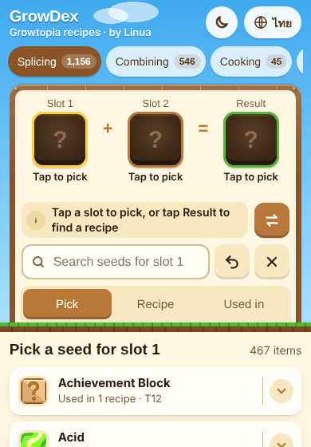
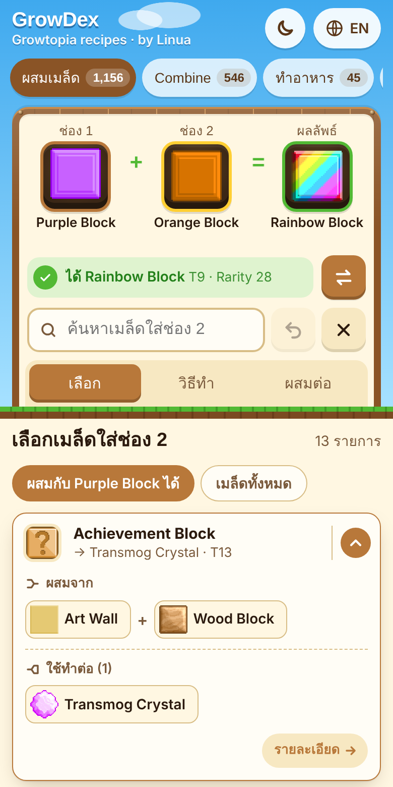
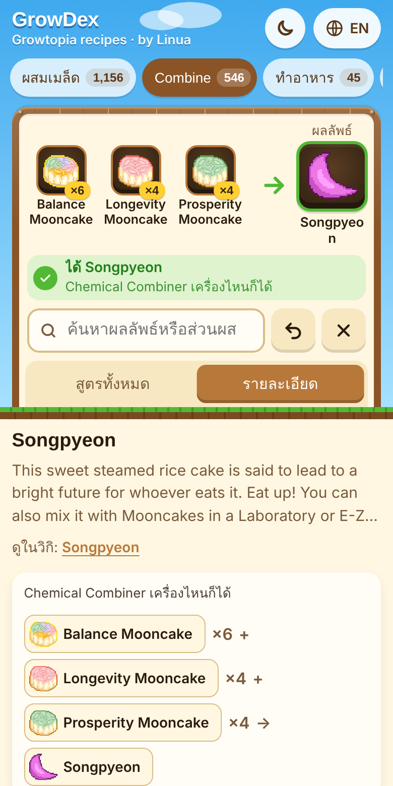
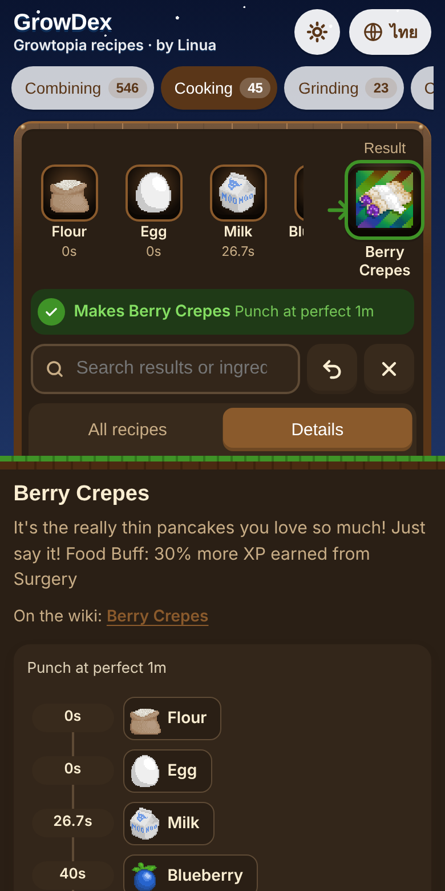
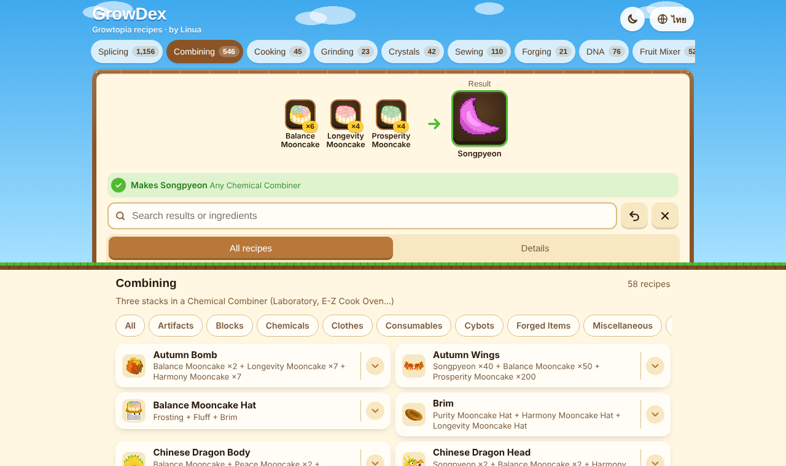

<div align="center">

# 🌱 GrowDex

**คลังสูตรทุกระบบของ Growtopia ในที่เดียว: ผสมเมล็ด, Combine, ทำอาหาร, บด, คริสตัล, เย็บผ้า, ตีเหล็ก, DNA, ปั่นผลไม้ และไอเทมทุกชิ้นพร้อมวิธีได้มา**

Every Growtopia recipe in one place, in Thai and English.




</div>

---

## สารบัญ

- [มีระบบอะไรบ้าง](#มีระบบอะไรบ้าง)
- [ใช้งานยังไง](#ใช้งานยังไง)
- [ภาพตัวอย่าง](#ภาพตัวอย่าง)
- [เปิดใช้ / เปิดเป็นเว็บ](#เปิดใช้--เปิดเป็นเว็บ)
- [ข้อมูลมาจากไหน](#ข้อมูลมาจากไหน)
- [โครงสร้างโปรเจกต์](#โครงสร้างโปรเจกต์)
- [อัปเดตข้อมูลเมื่อเกมออกแพตช์](#อัปเดตข้อมูลเมื่อเกมออกแพตช์)
- [รูปไอเทมจริง (ใช้ส่วนตัว)](#รูปไอเทมจริง-ใช้ส่วนตัว)
- [เครดิตและสัญญาอนุญาต](#เครดิตและสัญญาอนุญาต)
- [English](#english)

## มีระบบอะไรบ้าง

| ระบบ | จำนวน | ในเว็บแสดงอะไร |
|---|---:|---|
| 🌱 ผสมเมล็ด (Splicing) | 1,160 | เครื่องผสม 2 ช่อง, สลับช่อง, ผังวิธีทำย้อนถึงเมล็ดพื้นฐาน, สูตรอีเวนต์ (WinterFest, Mutant Kitchen), สูตรที่สุ่มได้หลายอย่าง และสูตรที่มีโอกาสได้ |
| 🧪 Combine | 546 | ของ 3 อย่างพร้อมจำนวน, จำนวนที่ได้, เครื่องที่ต้องใช้, หมวด (Chemicals, Consumables/Potion, Clothes, Mooncake ของ Harvest Festival และอีเวนต์อื่นๆ) |
| 🍳 ทำอาหาร | 45 | ไทม์ไลน์ว่าใส่อะไรตอนวินาทีที่เท่าไหร่ เครื่องปรุงที่ไม่ใส่ก็ได้ และเวลาต่อยเตา |
| ⚙️ บด (Food Grinder) | 23 | ของที่บดได้ พร้อมจำนวน |
| 💎 คริสตัล | 42 | คริสตัล 5 ชิ้นที่ต้องใช้ |
| 🧵 เย็บผ้า | 110 | ผ้า 3 ผืนกับฝีเข็มที่ใช้ตามลำดับ |
| 🔨 ตีเหล็ก | 21 | วัตถุดิบและจำนวน |
| 🧬 DNA | 76 | DNA 3 เส้นและจำนวนที่ได้ |
| 🍓 ปั่นผลไม้ | 52 | ผลไม้ที่ต้องมีในสูตร |
| ✦ อื่นๆ | 233 | หั่นบนเขียง, ของจากการผ่าตัด, Chemsynth, เตรียมฟอสซิล, อัดเสื้อผ้า, Anomalizer |
| 📖 ไอเทมทั้งหมด | 7,501 | คำอธิบายไอเทม, วิธีทำทุกระบบ, ใช้ทำอะไรต่อ และวิธีได้มาแบบอื่น (ร้านค้า, เปิดกล่อง, ทุบ, ตกปลา, NPC, Grow Pass ฯลฯ) |

## ใช้งานยังไง

- **แถบระบบ** ด้านบน: เลือกระบบที่อยากดู ตัวเลขคือจำนวนสูตร
- **ผสมเมล็ด:** แตะช่อง 1 / 2 แล้วเลือกเมล็ด หรือแตะช่องผลลัพธ์เพื่อหาสูตร
- **ระบบอื่น:** เลือกสูตรจากรายการ ส่วนผสมจะขึ้นบนเครื่องด้านบนพร้อมจำนวน แท็บ **รายละเอียด** แสดงสูตรเต็มและทุกวิธีที่ได้ของชิ้นนั้น
- **ลูกศร** ท้ายแต่ละแถว: ดูว่าทำจากอะไรและใช้ทำอะไรต่อ กดชื่อในนั้นเพื่อไล่ต่อได้เรื่อยๆ
- **ย้อนกลับ** ↶ และ **ล้าง** ✕ อยู่ข้างช่องค้นหา
- ปุ่ม **พระอาทิตย์/พระจันทร์** สลับโทนสว่าง/มืด และปุ่ม **รูปโลก** สลับไทย/อังกฤษ เว็บจำค่าที่เลือกไว้

## ภาพตัวอย่าง

<p align="center">
  
  
  
</p>
<p align="center">
  
</p>

> รูปในเว็บเป็นเมล็ดที่วาดขึ้นเอง สีและลายสร้างจากชื่อไอเทม ไม่ใช่ภาพจากเกม

## เปิดใช้ / เปิดเป็นเว็บ

**เปิดในเครื่อง:** ดาวน์โหลด repo (ปุ่ม **Code → Download ZIP**) แตกไฟล์ แล้วดับเบิลคลิก `index.html` ไม่ต้องลงอะไร ไม่ต้องต่อเน็ต

**ไฟล์เดียว:** `python tools/build_single.py` จะได้ `dist/growdex.html` ไว้ส่งต่อหรือเก็บในมือถือ

**GitHub Pages:**

1. อัปไฟล์ทั้งหมดขึ้น repo (`index.html` ต้องอยู่นอกสุด)
2. **Settings → Pages → Source: Deploy from a branch** เลือก `main` และ `/ (root)` กด **Save**
3. รอ 1–2 นาที จะได้ลิงก์ `https://<ชื่อผู้ใช้>.github.io/<ชื่อ-repo>/`

> 🔗 **เดโม:** `https://<ชื่อผู้ใช้>.github.io/<ชื่อ-repo>/` ← เปลี่ยนเป็นลิงก์จริงหลังเปิด Pages

## ข้อมูลมาจากไหน

ทุกหน้าไอเทมใน [Growtopia Wiki](https://growtopiawiki.com) เขียนวิธีทำไว้เป็นแม่แบบ เช่น `{{RecipeSplice|Purple Block|Orange Block}}` หรือ `{{RecipeCombine|Balance Mooncake|6|Longevity Mooncake|4|Prosperity Mooncake|4}}` เครื่องมือในโปรเจกต์นี้อ่านแม่แบบพวกนี้จาก **หน้าไอเทมทุกหน้า** ผ่าน API ของวิกิ จึงครบกว่าหน้ารวมสูตร (guide) ที่บางทีตกหล่น

ข้อมูลชุดนี้ดึงเมื่อ 26 พฤศจิกายน 2026 อ่าน 8,803 หน้า ได้ข้อมูลไอเทม 7,914 หน้า

## โครงสร้างโปรเจกต์

```
├── index.html              หน้าเว็บ
├── css/style.css           หน้าตาและเอฟเฟกต์
├── js/
│   ├── app.js              การทำงานทั้งหมด
│   ├── i18n.js             ข้อความไทย/อังกฤษ (เพิ่มภาษาได้)
│   ├── seeds.js            วาดรูปเมล็ด (ใช้ js/icons.js แทนถ้ามี)
│   ├── data.js             สูตรทุกระบบ (สร้างจาก tools/build_data.py)
│   └── items.js            คำอธิบายไอเทม + วิธีได้มาแบบอื่น
├── data/
│   ├── recipes.json        สูตรทุกระบบแบบอ่านง่าย
│   ├── obtain.json         วิธีได้มาแบบอื่นของแต่ละไอเทม
│   └── legacy_splicables.txt  ค่า rarity จาก GrowtopiaItemDatabase
├── tools/                  เครื่องมือ Python
└── docs/                   ภาพใน README
```

ไม่มีขั้นตอน build ไม่มี framework เป็น HTML + CSS + JavaScript ล้วน

| คำสั่ง | ใช้ทำอะไร |
|---|---|
| `python tools/fetch_wiki.py` | ดึงข้อมูลจากวิกิ → `data/raw/wiki_dump.json` (ต้อง `pip install requests`) |
| `python tools/build_data.py` | แปลงข้อมูลดิบเป็น `js/data.js`, `js/items.js`, `data/*.json` |
| `python tools/build_single.py` | รวมทั้งเว็บเป็นไฟล์เดียว `dist/growdex.html` |
| `python tools/make_icons.py --game ... --items ...` | สร้างรูปไอเทมจากเกมในเครื่อง (ใช้ส่วนตัว) |
| `python tools/rttex.py <โฟลเดอร์> <ปลายทาง>` | แปลงไฟล์ `.rttex` เป็น PNG |
| `python tools/items_dat.py <items.dat>` | อ่านรายชื่อไอเทมจาก `items.dat` |

## อัปเดตข้อมูลเมื่อเกมออกแพตช์

```bash
pip install requests
python tools/fetch_wiki.py
python tools/build_data.py
```

ใช้เวลาไม่กี่นาที (ราว 180 ครั้งที่เรียก API ของวิกิ มีหน่วงเวลาไว้ไม่ให้วิกิทำงานหนัก) วันที่ดึงข้อมูลจะขึ้นท้ายเว็บเอง

## รูปไอเทมจริง (ใช้ส่วนตัว)

รูปไอเทมเป็นลิขสิทธิ์ของเกม repo นี้จึงไม่มีรูปพวกนั้น ถ้ามีเกมในเครื่อง สร้างไว้ดูเองได้ (ต้อง `pip install pillow`):

```bash
python tools/make_icons.py --game "%LOCALAPPDATA%\Growtopia\game" --items "%LOCALAPPDATA%\Growtopia\cache\items.dat"
```

ได้ `js/icons.js` แล้วเว็บจะใช้รูปจริงแทนรูปวาด ไฟล์นี้อยู่ใน `.gitignore` แล้ว

สคริปต์เลือกรูปแบบเดียวกับในเกม: ใช้รูปใหม่ใน `cache\game` ก่อน ใช้ไฟล์ `*_icon.rttex` (รูปช่องกระเป๋า) ถ้ามี วาดเมล็ดจาก `seed.rttex` ตามสีของเมล็ดนั้น และใส่สีให้ไอเทมที่เกมใช้รูปขาวรูปเดียวแล้วย้อมสีเอา เช่น คริสตัล ผ้าไหม ชุดซูเปอร์ฮีโร่


## เครดิตและสัญญาอนุญาต

- **ข้อมูลสูตรและไอเทม:** [Growtopia Wiki](https://growtopiawiki.com) ใช้สัญญาอนุญาต [CC BY-NC-SA 4.0](https://creativecommons.org/licenses/by-nc-sa/4.0/) ใช้และแจกต่อได้ถ้าให้เครดิตวิกิ ห้ามใช้หาเงิน และต้องแจกต่อด้วยสัญญาเดียวกัน
- **ค่า rarity:** [GrowtopiaItemDatabase](https://github.com/iRestartz/GrowtopiaItemDatabase) โดย Nenkai ([CC BY 4.0](https://creativecommons.org/licenses/by/4.0/))
- **ฟอนต์:** [Mitr](https://fonts.google.com/specimen/Mitr) และ [IBM Plex Sans Thai](https://fonts.google.com/specimen/IBM+Plex+Sans+Thai)
- **โค้ด:** MIT © 2026 Linua

รายละเอียดอยู่ในไฟล์ [LICENSE](LICENSE) · เว็บแฟนเมด ไม่เกี่ยวข้องกับ Ubisoft หรือ Growtopia ชื่อเกมและภาพในเกมเป็นของเจ้าของลิขสิทธิ์

---

## English

**GrowDex** collects every Growtopia recipe system in one fast, offline-friendly page: splicing (1,160), combining (546, including Harvest Festival mooncakes and guild potions), cooking timelines (45), grinding, crystals, sewing, forging, DNA, fruit mixing, cutting/surgery/Chemsynth/fossils, plus all 7,501 items with every way to get them.

Data is read from the recipe templates on every item page of the [Growtopia Wiki](https://growtopiawiki.com) through its API (`tools/fetch_wiki.py`, then `tools/build_data.py`). Open `index.html` directly, build a single file with `tools/build_single.py`, or host it with GitHub Pages.

Item icons are game art and are not included; `tools/make_icons.py` can build `js/icons.js` from your own install for personal use (git-ignored). It picks icons the way the game does: updated textures in `cache/game` first, the `*_icon.rttex` inventory sheets, seeds drawn from `seed.rttex` in their own colours, and colours for items the game tints from one white sprite (crystals, silk, superhero gear).

**Licenses:** code MIT © 2026 Linua · recipe/item data CC BY-NC-SA 4.0 (Growtopia Wiki) · rarity CC BY 4.0 (Nenkai) · fan-made, not affiliated with Ubisoft or Growtopia.
